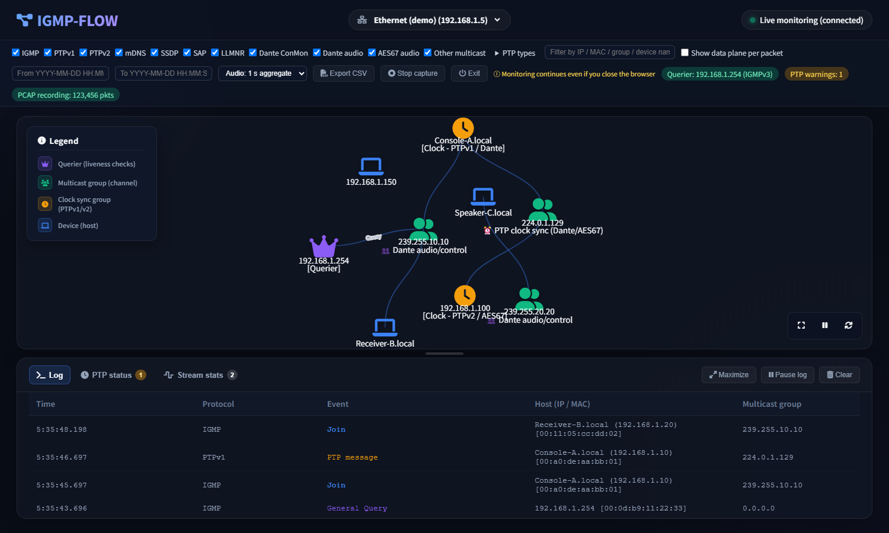
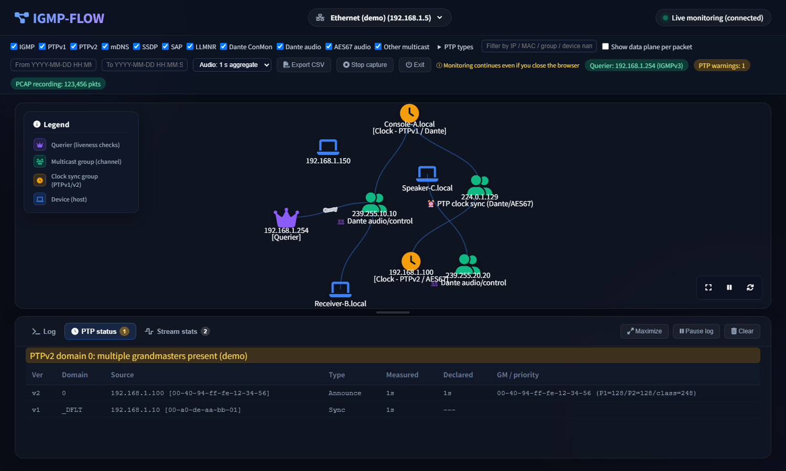

# IGMP-FLOW

[日本語版はこちら / Japanese: README_JP.md](README_JP.md)

Real-time multicast visualizer and recorder for audio/video networks (Dante, AES67, SMPTE ST 2110).
IGMP-FLOW passively captures IGMP and multicast traffic on a mirror (SPAN) port or a normal NIC,
draws who joins which multicast group, watches the IGMP querier and PTP clock health, and keeps a
complete PCAP record for later troubleshooting.

## Screenshots

Generated from the built-in demo (`python scripts/demo_simulator.py`); all names and addresses are fictional.





## Features

- **Topology map**: queriers, hosts and multicast groups, updated live from IGMP Join / Leave / Query.
- **IGMP analysis**: IGMPv1/v2/v3. IGMPv3 Reports are expanded per Group Record (include/exclude, sources).
  Query version (v1/v2/v3), max response time, robustness (QRV) and QQIC are shown.
- **Querier monitor**: detects a missing querier and multiple queriers (the lowest IP should win the election).
- **PTP (v1 / v2) monitor**: per-clock message intervals (measured vs. declared), grandmaster ID, priorities and
  clock class. Warns on lost Announce, multiple grandmasters and interval mismatch.
- **Protocol names**: mDNS, SSDP, SAP, LLMNR, Dante ConMon, Dante audio, AES67 audio, other multicast.
- **Lossless recording**: every captured packet is written to PCAP. Audio (data plane) packets keep headers only
  (128 bytes) to save space; control-plane packets are stored in full.
- **CSV on demand**: CSV files are generated from the PCAP files (time range, protocol, group, text filters), so
  an analysis fix can be applied to old captures by simply exporting again.
- **UI filters (server side)**: protocol (PTPv1 and PTPv2 separately), PTP message type, free text. Audio streams
  are shown as 1-second statistics instead of one row per packet.

## Requirements

- Windows 10/11 with **[Npcap](https://npcap.com/) installed** (separate download, default options; not bundled). Administrator
  rights may be needed, depending on how Npcap was installed.
- Python 3.12 and the packages `scapy` and `websockets` (only when running from source; `IGMP-FLOW.exe` needs no Python).
- A web browser. The UI is served locally at `http://localhost:8000` and loads two libraries from public CDNs, so the PC
  showing it needs internet access.
- A managed switch with port mirroring (SPAN) to see other devices' traffic. No database or other service is needed.

Step-by-step installation, screen guide and troubleshooting: **[User manual](docs/manual_EN.md)**.

To see IGMP traffic from other devices, connect the capture NIC to a **mirror (SPAN) port** of the switch.
Virtual adapters (for example Hyper-V) only see the host's own traffic.

## Quick start

From source (run in an elevated terminal):

```bash
python -m pip install -r requirements.txt
python app.py
```

Or run the packaged `IGMP-FLOW.exe` as administrator. The browser opens automatically.

Options:

| Option | Description |
|---|---|
| `-i, --interface` | NIC GUID / device name. Auto-selected if omitted. |
| `--interactive` | Choose the NIC on the console. |
| `-p, --port` | WebSocket port (default 8765). |
| `--capture-dir` | PCAP directory (default: `captures` inside the data folder, see "Where your data is stored"). |
| `--no-pcap` | Disable PCAP recording (not recommended). |
| `--live-csv igmp\|all\|off` | Live CSV in `./logs` (default: IGMP events only). |
| `--no-close-prompt` | Do not ask whether to exit when the browser is closed. |

Closing the browser does **not** stop the app: monitoring and recording continue. Use the **Exit** button in the UI,
answer **Yes** in the dialog that appears after the browser is closed, or end `IGMP-FLOW` in Task Manager.
Starting a second instance only opens the existing page.

## Using the UI

- **Filters** (top bar) are applied on the server. Everything is still recorded to PCAP.
- **Bottom panel tabs**: Log / PTP status / Stream stats. Drag the divider to resize, or use Maximize.
- **Pause log** stops adding rows to the log view only; **Stop capture** stops capturing (and PCAP recording) itself.
- The restart button on the map clears the map, log and monitors and starts a new PCAP file. The tool is passive,
  so the map is rebuilt from the Queries/Reports that arrive afterwards (typically up to the query interval, 125 s).

## Where your data is stored

Captures, CSV exports and logs contain real IP/MAC addresses and device names, so they are **not** kept in the project
folder. By default they go to `%LOCALAPPDATA%\IGMP-FLOW\data` on Windows (not cloud-synced, readable only by your user
account by default) and `~/.local/share/igmp-flow` elsewhere, in the sub-folders `captures`, `exports` and `logs`.
Set the environment variable `IGMP_FLOW_DATA_DIR` to use another folder. If a data folder looks like it lives inside
OneDrive, Dropbox, Google Drive or similar, the app warns you at startup and in the UI.

## Exporting CSV

In the UI use **Export CSV** (output goes to the `exports` folder in the data folder), or from the command line:

```bash
python -m backend.pcap_export captures/example.pcap -o out.csv --proto IGMP --proto PTPv2 --ptp-type Announce
```

Columns: Timestamp, Event, Device Name, IP Address, MAC Address, Multicast Group, Protocol, Packets, Detail,
Event Code. Times are local time of the PC that exports. Audio rows are aggregated per second and flow by
default (`--data raw` for every packet, `--data none` to omit).

## Security notes

- **Local only.** The UI server (port 8000) and the WebSocket server (port 8765) listen on `127.0.0.1` only.
  There is no authentication, so do not expose these ports (no port forwarding, no `0.0.0.0` binding).
- **Cross-site protection.** The WebSocket server accepts browser connections only from this app's own page
  (`http://localhost:8000` / `http://127.0.0.1:8000`), and the UI server rejects unexpected `Host` headers.
  Other web pages you visit cannot read the live data or send commands (e.g. exit, stop capture).
- **Untrusted network data.** Device names (mDNS), MACs and packet fields come from the network and are treated as
  untrusted: the UI renders them as plain text, caches have size limits, control characters are stripped, and CSV
  cells that start with `=`, `+`, `-` or `@` are prefixed with `'` so spreadsheets do not evaluate them.
- **Privilege and privacy.** Capturing needs administrator rights (Npcap). Capture files, CSV exports and logs contain
  real IP/MAC addresses and device names; they are stored outside the project folder (see above) and are git-ignored.
  Do not share them without reviewing them.
- **External resources.** The page loads `vis-network` (pinned version) and Font Awesome from public CDNs, restricted
  by a Content-Security-Policy, so the computer showing the UI needs internet access. Bundling these files locally is a
  possible future improvement for isolated networks. No web fonts or analytics are loaded.
- Please report vulnerabilities privately to the repository owner rather than in a public issue.

## Development

```bash
python -m pip install -r requirements-dev.txt
python -m pytest -q
```

Try the UI without hardware or Npcap: `python scripts/demo_simulator.py`.

Build the executable and a release folder (PyInstaller, Windows PowerShell). The release folder contains the license files that must
accompany the exe (see License below):

```bash
powershell -File scripts/build_exe.ps1
```

Project layout:

```
app.py                 entry point
backend/               capture, analysis, recording, servers (tests in backend/tests)
frontend/              the browser UI (HTML/JS/CSS)
docs/                  user manuals (EN/JP)
scripts/               build_exe.ps1, demo_simulator.py, generate_icon.py
assets/                application icon
licenses/              license texts of bundled third-party components
dist/, build/          build output (git-ignored)
```

## License and third-party software

IGMP-FLOW's source code is released under the [MIT License](LICENSE); anyone may use, modify and redistribute it.
It depends on third-party software, some of which has its own terms:

- **Scapy is GPL-2.0.** If you redistribute the prebuilt `IGMP-FLOW.exe` (which bundles Scapy), the executable must be
  distributed under GPL-2.0 terms with source available. Running from source is not affected.
- **Npcap is not included** and has its own license (limited free use, no redistribution; commercial deployments may
  need the paid OEM license). Install it yourself from <https://npcap.com/> and read its terms.
- The application icon is original artwork generated by `scripts/generate_icon.py`; no third-party images are included.

See [THIRD_PARTY_NOTICES.md](THIRD_PARTY_NOTICES.md) for the full list, versions and trademark notices
(Dante, AES67, SMPTE ST 2110 and other names are used only to describe compatibility).

## Known limitations

- Passive only: it never sends Queries or Reports.
- Only IPv4 multicast, IGMP and ARP are captured; unicast traffic is ignored.
- The declared Sync interval of PTPv1 is read from a header offset taken from the Wireshark dissector and has not
  been verified on real Dante hardware; values outside a sane range are ignored and the measured interval is shown.
- PCAP files are never deleted automatically; the UI warns when the capture folder becomes large.
