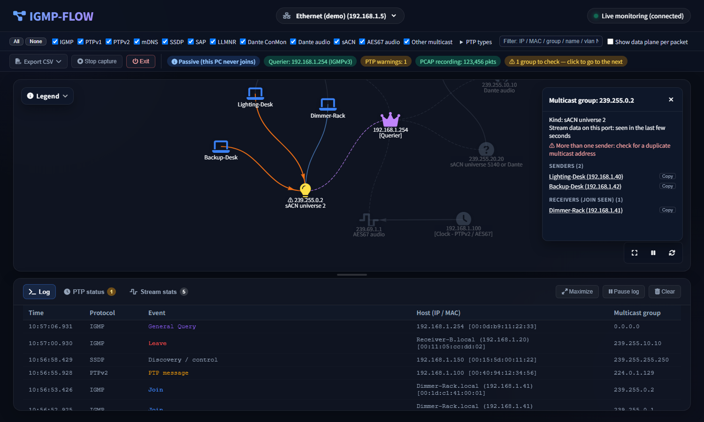
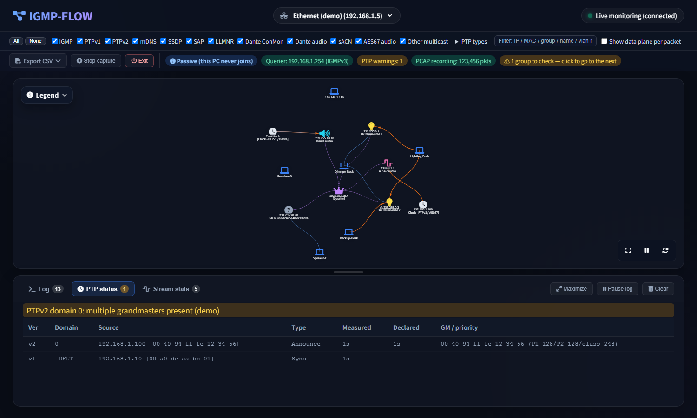

# IGMP-FLOW

[English: README.md](README.md)

音響・映像ネットワーク（Dante、AES67、SMPTE ST 2110）向けの、マルチキャストのリアルタイム可視化・記録ツールです。
ミラー（SPAN）ポートや通常の NIC で IGMP とマルチキャスト通信を受動的に取得し、
「どの機器がどのマルチキャストグループに参加しているか」を図示します。IGMP クエリアと PTP クロックの状態も監視し、
後からのトラブルシュート用に全パケットを PCAP に記録します。

## スクリーンショット

内蔵のデモ（`python scripts/demo_simulator.py`）から生成したものです。名前やアドレスはすべて架空です。





## 主な機能

- **トポロジ図**：クエリア、端末、マルチキャストグループを、IGMP の Join / Leave / Query からリアルタイムに描画します。
- **IGMP 解析**：IGMPv1/v2/v3 に対応。IGMPv3 Report は Group Record ごとに展開します（include/exclude、ソース）。
  Query のバージョン（v1/v2/v3）、最大応答時間、ロバストネス（QRV）、QQIC も表示します。
- **クエリア監視**：クエリアの不在と、複数クエリアの同時存在を検出します（選出では最小 IP が勝ちます）。
- **見えているかの確認**：IGMP-FLOW は自分からグループに Join しません。Query は届くのに他の機器の Join / Leave が見えない場合は
  警告し（ミラーポートではない可能性）、このポートにストリームのデータが届いていないグループは灰色で表示します。
- **PTP（v1 / v2）監視**：クロックごとのメッセージ間隔（実測と宣言値）、グランドマスター ID、プライオリティ、クロッククラスを表示します。
  Announce の途絶、複数のグランドマスター、間隔の不一致を警告します。
- **プロトコル名の表示**：mDNS、SSDP、SAP、LLMNR、Dante ConMon、Dante audio、sACN（照明）、AES67 audio、その他のマルチキャスト。
  sACN と Dante audio はどちらも 239.255.x.x を使うため、UDP ポート（sACN は 5568、Dante は 4321）で見分けます。
- **大規模なネットワーク**：グループや機器が多いときは、同じアドレス範囲のグループと、同じ /24 サブネットの機器を
  1 つのまとめノードで表示します。まとめノードをダブルクリックすると中身を表示します。
- **送信元と警告**：ストリームのデータがこのポートに届くと、どの機器がどのグループへ送っているかを矢印で示します。
  送信元が 2 台以上のグループと、データはあるのに受信者がいないグループには ⚠ を付けます。ノードをクリックすると
  つながるものを強調します。プロトコルのチェックと絞り込み欄は、図にも反映されます。
- **VLAN**：802.1Q のタグが見える場合は、グループとクエリアを VLAN ごとに表示し、複数クエリアも VLAN ごとに判定します。
  Windows では多くのアダプターがタグを外します。マニュアルの 10 章を参照してください。
- **欠落のない記録**：取得した全パケットを PCAP に書き込みます。音声（データ面）はヘッダのみ（128 バイト）に切り詰めて容量を抑え、
  制御系は全長で保存します。
- **必要なときに CSV 出力**：CSV は PCAP から生成します（期間、プロトコル、グループ、テキストで絞り込み）。
  解析を修正した場合も、過去のキャプチャから出力し直すだけで反映できます。
- **UI フィルタ（サーバー側）**：プロトコル（PTPv1 と PTPv2 は別）、PTP メッセージ種別、テキスト。
  音声ストリームは 1 パケット 1 行ではなく、1 秒ごとの統計で表示します。

## 動作環境

- **[Npcap](https://npcap.com/) をインストールした** Windows 10/11（別途ダウンロード、既定のオプション。同梱はしていません）。
  Npcap のインストール方法によっては、管理者権限が必要です。
- ソースから実行する場合のみ、Python 3.12 と、パッケージ `scapy`、`websockets`（`IGMP-FLOW.exe` に Python は不要です）。
- ブラウザ。UI は `http://localhost:8000` でローカル配信され、2 つの部品を公開 CDN から読み込むため、画面を表示する PC には
  インターネット接続が必要です。
- 他の機器の通信を見るための、ポートミラーリング（SPAN）のできるマネージドスイッチ。データベースなどのサービスは不要です。

インストール手順、画面の見方、トラブルシューティングは **[利用マニュアル](docs/manual_JP.md)** を参照してください。

他の機器の IGMP 通信を見るには、キャプチャ用 NIC をスイッチの**ミラー（SPAN）ポート**に接続してください。
仮想アダプタ（Hyper-V など）では、ホスト自身の通信しか見えません。

IGMP-FLOW は受信するだけで、**自分からマルチキャストグループに Join しません**。IGMP Snooping が有効なスイッチは、Join したポートにしか
ストリームを転送しません。そのため、図にグループが出ていても、このポートではストリームのデータが見えないことがあります。これは正常で、
ストリームが流れていないという意味ではありません。データを見ていないグループは灰色で表示し、ツールチップにこのポートでの観測状態を出します。
他の機器の Join / Leave も同じで、スイッチは IGMP Report をルーター（クエリア）側のポートにしか転送しません。Query が届いているのに
他の機器の Report が 30 秒以内に 1 件も見えない場合は、「No Join/Leave seen: this port may not be a mirror (SPAN) port」と表示します。

## 起動方法

ソースから（管理者権限のターミナルで）：

```bash
python -m pip install -r requirements.txt
python app.py
```

または、パッケージ済みの `IGMP-FLOW.exe` を管理者として実行します。ブラウザは自動で開きます。

オプション：

| オプション | 説明 |
|---|---|
| `-i, --interface` | NIC の GUID／デバイス名。省略時は自動選択。 |
| `--interactive` | コンソールで NIC を選択。 |
| `-p, --port` | WebSocket のポート（既定 8765）。 |
| `--capture-dir` | PCAP の保存先（既定：データフォルダ内の `captures`。「データの保存場所」を参照）。 |
| `--no-pcap` | PCAP 記録を無効化（非推奨）。 |
| `--live-csv igmp\|all\|off` | `./logs` へのライブ CSV（既定は IGMP イベントのみ）。 |
| `--no-close-prompt` | ブラウザを閉じたときの終了確認ダイアログを出さない。 |

ブラウザを閉じても、アプリは**停止しません**（監視と記録は続きます）。止めるには、UI の **Exit** ボタンを使うか、
ブラウザを閉じたあとに出るダイアログで **はい** を選ぶか、タスクマネージャーで `IGMP-FLOW` を終了してください。
2 つ目を起動した場合は、既存の画面を開くだけです。

## 画面の使い方

- 上部の**フィルタ**はサーバー側で適用されます。絞り込んでも、全パケットは PCAP に記録されます。
- **下パネルのタブ**：ログ／PTP 状態／ストリーム統計。境界をドラッグして高さを変えられます。最大化も可能です。
- **ログ一時停止**はログへの追加だけを止めます。**キャプチャ停止**は取得（と PCAP への記録）そのものを止めます。
- マップ上の再起動ボタンは、図・ログ・監視を初期化して PCAP を新しいファイルに切り替えます。受動監視のため、図は以降に届く
  Query／Report から再構築されます（通常は Query 間隔、125 秒程度まで）。

## データの保存場所

キャプチャ、CSV、ログには実際の IP/MAC アドレスや機器名が含まれるため、プロジェクトのフォルダには**置きません**。
既定では、Windows は `%LOCALAPPDATA%\IGMP-FLOW\data`（クラウド同期の対象外で、既定では自分のアカウントだけが読める場所）、
それ以外は `~/.local/share/igmp-flow` に、サブフォルダ `captures`、`exports`、`logs` として保存します。
別の場所にするには、環境変数 `IGMP_FLOW_DATA_DIR` を設定してください。保存先が OneDrive、Dropbox、Google Drive などの中にありそうな
場合は、起動時と画面で警告します。

## CSV の出力

UI の **Export CSV**（出力先はデータフォルダ内の `exports`）、またはコマンドラインで：

```bash
python -m backend.pcap_export captures/example.pcap -o out.csv --proto IGMP --proto PTPv2 --ptp-type Announce
```

列：Timestamp、Event、Device Name、IP Address、MAC Address、Multicast Group、Protocol、Packets、Detail、Event Code。
時刻は、出力を実行した PC のローカル時刻です。音声の行は、既定で 1 秒×フローに集計します
（`--data raw` で全件、`--data none` で除外）。

## セキュリティについて

- **ローカル専用です。** UI サーバー（ポート 8000）と WebSocket サーバー（ポート 8765）は `127.0.0.1` だけで待ち受けます。
  認証はないため、これらのポートを外部に公開しないでください（ポート転送や `0.0.0.0` での待ち受けはしないこと）。
- **他サイトからの操作を防ぎます。** WebSocket は、このアプリ自身のページ（`http://localhost:8000` / `http://127.0.0.1:8000`）
  からのブラウザ接続だけを受け付け、UI サーバーは想定外の `Host` ヘッダを拒否します。閲覧中の他のウェブページが、
  リアルタイムのデータを読んだり、コマンド（終了、キャプチャ停止など）を送ったりすることはできません。
- **ネットワーク由来のデータは信頼しません。** 機器名（mDNS）、MAC、パケットの各項目はネットワークから来る値として扱います。
  画面にはプレーンテキストで表示し、キャッシュには上限を設け、制御文字は除去します。CSV で `=`、`+`、`-`、`@` で始まるセルは、
  表計算ソフトが数式として評価しないよう、先頭に `'` を付けて出力します。
- **権限とプライバシー。** キャプチャには管理者権限（Npcap）が必要です。キャプチャファイル、CSV、ログには、実際の IP/MAC
  アドレスと機器名が含まれます。これらはプロジェクトのフォルダの外（上記）に保存し、git の管理対象外にしています。
  内容を確認せずに共有しないでください。
- **外部リソース。** 画面は `vis-network`（バージョン固定）と Font Awesome を公開 CDN から読み込み、Content-Security-Policy で
  読み込み元を制限しています。そのため、画面を表示する PC にはインターネット接続が必要です。閉じたネットワーク向けに、これらを
  同梱する改善は今後の課題です。Web フォントや解析ツールは読み込みません。
- 脆弱性は、公開の issue ではなく、リポジトリの所有者へ非公開で報告してください。

## 開発

```bash
python -m pip install -r requirements-dev.txt
python -m pytest -q
```

機材や Npcap が無くても画面を試せます：`python scripts/demo_simulator.py`。

実行ファイルと配布用フォルダのビルド（PyInstaller、Windows PowerShell）。配布用フォルダには、exe に添える必要のあるライセンス文書が入ります
（下の「ライセンス」を参照）：

```bash
powershell -File scripts/build_exe.ps1
```

フォルダ構成：

```
app.py                 エントリーポイント
backend/               キャプチャ、解析、記録、サーバー（テストは backend/tests）
frontend/              ブラウザの画面（HTML/JS/CSS）
docs/                  利用マニュアル（英語/日本語）
scripts/               build_exe.ps1、demo_simulator.py、generate_icon.py
assets/                アプリのアイコン
licenses/              同梱するサードパーティのライセンス文書
dist/, build/          ビルドの出力（git の管理対象外）
```

## ライセンスとサードパーティ

IGMP-FLOW のソースコードは [MIT ライセンス](LICENSE) で公開しています。誰でも利用、改変、再配布できます。
ただし、依存するサードパーティのソフトウェアには、それぞれの条件があります。

- **Scapy は GPL-2.0 です。** Scapy を同梱したビルド済みの `IGMP-FLOW.exe` を再配布する場合は、実行ファイル全体を GPL-2.0 の
  条件で配布し、ソースを入手できる状態にする必要があります。ソースから実行する場合は影響しません。
- **Npcap は同梱していません。** 独自のライセンスがあります（無料版は利用に制限があり、再配布不可。組織での大規模な導入には、
  有料の OEM ライセンスが必要な場合があります）。<https://npcap.com/> から各自でインストールし、条件を確認してください。
- アプリのアイコンは `scripts/generate_icon.py` で生成した自作の画像です。第三者の画像は含みません。

一覧、バージョン、商標の表記は [THIRD_PARTY_NOTICES.md](THIRD_PARTY_NOTICES.md) を参照してください
（Dante、AES67、SMPTE ST 2110 などの名称は、互換性を説明する目的でのみ使用しています）。

## 既知の制限

- 受動監視のみです。Query や Report を自分から送信することはありません。
- 取得するのは IPv4 のマルチキャスト、IGMP、ARP のみです。ユニキャスト通信は対象外です。
- PTPv1 の Sync 宣言間隔は、Wireshark の解析定義から得たヘッダ位置で読んでおり、実機の Dante では未検証です。妥当な範囲外の値は
  無視し、実測間隔を表示します。
- PCAP は自動では削除されません。保存先が大きくなると、UI が警告します。
